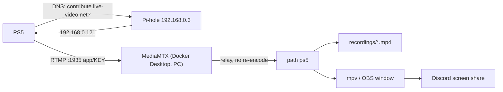

# mediamtx-poc

Show the PS5's picture in a window on the PC and share it in Discord, without a capture card and without Remote
Play. The same stream is recorded to disk.

**Status: proof of concept.** Tested with a simulated PS5 stream (1080p60 H.264 + AAC) on Linux; not yet tested
with the real console or on Docker Desktop for Windows.

## How it works



1. The PS5 starts an ordinary Twitch broadcast.
2. Pi-hole answers `contribute.live-video.net` (and all its subdomains) with the PC's IP instead of Twitch's.
   The PS5 already uses Pi-hole via DHCP, so nothing changes on the console.
3. MediaMTX accepts the stream on `app/<stream key>` and relays it, without re-encoding, to the fixed path
   `ps5`. Players never need the stream key.
4. `ps5` is recorded and can be played with mpv or OBS; that window is shared in Discord.

Nothing reaches Twitch.

## Setup (once)

1. **Fixed IP for the PC.** It must keep `192.168.0.121` (DHCP reservation on the router), and should be on a
   cable, not Wi-Fi.
2. **Twitch linked on the PS5:** Settings → Users and Accounts → Link with Other Services → Twitch.
3. **Firewall:** allow inbound TCP 1935 on private networks. Docker Desktop usually asks on first start;
   otherwise, in an elevated PowerShell:

   ```powershell
   New-NetFirewallRule -DisplayName "PS5 RTMP" -Direction Inbound -Protocol TCP -LocalPort 1935 -Profile Private -Action Allow
   ```

4. **mpv** for low-latency playback: `winget install shinchiro.mpv`

## Use

1. Start the server, from the repository root:

   ```bash
   docker compose up -d
   ```

2. **Switch the redirect on** in Pi-hole. `misc.dnsmasq_lines` is read-only in the web UI, so set it over SSH on
   the Pi:

   ```bash
   sudo docker exec pihole pihole-FTL --config misc.dnsmasq_lines '["address=/contribute.live-video.net/192.168.0.121"]'
   ```

   Check from the PC: `nslookup ingest.global-contribute.live-video.net 192.168.0.3` must answer
   `192.168.0.121` (if not, `sudo docker restart pihole`). The PS5 caches DNS answers: restart it or reconnect
   its network.
3. On the PS5 press **Create → Broadcast → Twitch** and start.
4. Watch:

   ```bash
   mpv --profile=low-latency rtmp://localhost/ps5
   ```

   or in OBS: Media Source, untick "Local File", input `rtmp://localhost/ps5`.
5. Share the mpv/OBS window in Discord.
6. Recordings land in `recordings/` as `ps5_<date>_<time>.mp4` (fMP4, one file per hour).

**Stop:** end the broadcast, `docker compose down`, and **switch the redirect off again** (see caveats):

```bash
sudo docker exec pihole pihole-FTL --config misc.dnsmasq_lines '[]'
```

## Caveats

- **The Pi-hole line affects the whole LAN.** While it is set, any Twitch stream from any device (e.g. OBS on
  the PC) goes to MediaMTX instead of Twitch. Only keep it while you need it.
- If the PC is off while the line is set, the PS5 broadcast just fails; it does not fall back to Twitch.
- The container log (`docker compose logs`) shows the real Twitch stream key in the path name. Don't post it.
- Only Twitch works as a target. Scenes the game blocks from broadcasting stay black.
- If the PS5 ever switches to RTMPS (port 443), nothing arrives here. That is the most likely way this breaks.
- Discord without Nitro limits screen sharing to 720p30; the recording keeps the full 1080p60.

## Configuration

Optional overrides go into `.env` (copy `.env.template`): image tag, `RECORD=false` to only relay, and
`RECORDINGS_DIR` to record elsewhere (e.g. `D:/Videos/PS5`).

## Background

The idea comes from Yash Garg's "Hijacking the PS5's RTMP Stream". Instead of the dnsmasq + nginx-rtmp setup
from [ImLunaHey/playstation-rtmp](https://github.com/ImLunaHey/playstation-rtmp), this uses the existing
Pi-hole for DNS and [MediaMTX](https://github.com/bluenviron/mediamtx) as the RTMP server, which can relay and
record on its own.
