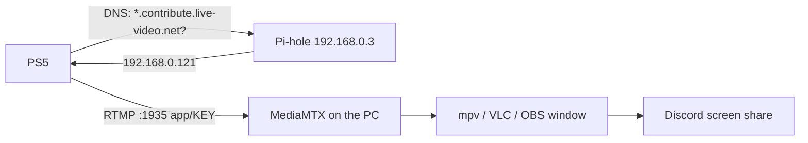

# mediamtx-poc

Show the PS5's picture in a window on the PC and share it in Discord, without a capture card and without Remote
Play.

## Status

| Variant | State |
| --- | --- |
| **Native `mediamtx.exe` on Windows**, default config | **Works with the real PS5** (tested 2026-11-18): the PS5 publishes 1080p H.264 + AAC, playback in mpv/VLC. |
| Docker (`compose.yaml`, relay to a fixed path, recording) | **Deferred.** Only tested with a simulated PS5 stream on Linux, never on Docker Desktop or with the console. |

## How it works



1. The PS5 starts an ordinary Twitch broadcast.
2. Pi-hole answers Twitch's ingest domains with the PC's IP. The PS5 already uses Pi-hole via DHCP, so nothing
   changes on the console. This works because the PS5 asks Pi-hole directly, not the router, whose DNS rebind
   protection would drop a private answer for a public domain.
3. MediaMTX accepts the stream on `app/<stream key>`; a player shows it, and that window is shared in Discord.

Nothing reaches Twitch.

## Prerequisites (once)

- **PC** `192.168.0.121`, on a cable. It should keep that IP (DHCP reservation on the router).
- **PS5** (`192.168.0.250` in the test) with DNS on automatic and Twitch linked: Settings → Users and Accounts →
  Link with Other Services → Twitch.
- **Firewall:** inbound TCP 1935 on private networks. Windows asks when `mediamtx.exe` first starts; otherwise, in
  an elevated PowerShell:

  ```powershell
  New-NetFirewallRule -DisplayName "PS5 RTMP" -Direction Inbound -Protocol TCP -LocalPort 1935 -Profile Private -Action Allow
  ```

- **A player:** mpv (`winget install shinchiro.mpv`) or VLC.

## Pi-hole redirect

`misc.dnsmasq_lines` is read-only in the Pi-hole web UI, so it is set over SSH on the Pi.

**On:**

```bash
sudo docker exec pihole pihole-FTL --config misc.dnsmasq_lines '["address=/contribute.live-video.net/192.168.0.121","address=/contribute.live-video.net/::","address=/global-contribute.live-video.net/192.168.0.121","address=/global-contribute.live-video.net/::"]'
sudo docker restart pihole
```

- `global-contribute.live-video.net` is a separate domain, not a subdomain of `contribute.live-video.net`. The
  PS5 asks for `ingest.global-contribute.live-video.net`, which is a CNAME into `contribute.live-video.net`;
  dnsmasq only matches the name asked for, so both are listed.
- The `::` lines stop the PS5 from reaching Twitch over IPv6.
- The restart clears Pi-hole's cache; without it the old Twitch answers stay for a while. The network has no DNS
  for a few seconds.

**Check** from the PC before broadcasting:

```powershell
ipconfig /flushdns
nslookup ingest.global-contribute.live-video.net 192.168.0.3
nslookup euc10.contribute.live-video.net 192.168.0.3
```

Both must answer only `::` and `192.168.0.121`. If the real Twitch addresses still show up, **do not start the
broadcast** — it would go to Twitch for real.

**Off** (after every session):

```bash
sudo docker exec pihole pihole-FTL --config misc.dnsmasq_lines '[]'
sudo docker restart pihole
```

## Variant A: native mediamtx.exe (tested)

1. Download `mediamtx_<version>_windows_amd64.zip` from the
   [MediaMTX releases](https://github.com/bluenviron/mediamtx/releases), unpack, start `mediamtx.exe`. The
   default `mediamtx.yml` next to it is enough.
2. Switch the Pi-hole redirect on and check it (above).
3. Restart the PS5 so it forgets cached DNS answers.
4. PS5: **Create → Broadcast → Twitch → Go Live.**
5. The MediaMTX window shows

   ```
   INF [RTMP] [conn 192.168.0.250:…] is publishing to path 'app/live_…'
   ```

6. Play that path:

   ```powershell
   mpv --profile=low-latency rtmp://localhost/app/live_…
   ```

   VLC: Media → Open Network Stream (Ctrl+N), same URL; set *Caching* under "Show more options" to 200–300 ms,
   or start it with `vlc.exe --network-caching=300 rtmp://localhost/app/live_…`. OBS: Media Source, untick
   "Local File", same URL.
7. Share the player window in Discord.
8. End the broadcast, close MediaMTX, switch the redirect off.

**Recording at the same time:** edit the `mediamtx.yml` next to the exe, section `pathDefaults:`, and restart
MediaMTX:

```yaml
  record: true
  recordPath: D:/Videos/PS5/%path/%Y-%m-%d_%H-%M-%S-%f_%z
  recordDeleteAfter: 0s
```

- MediaMTX records every broadcast as fMP4 (`.mp4`, one file per hour) without re-encoding, independent of the
  player. The file can be opened in VLC while it is still being written.
- `recordDeleteAfter` defaults to `1d`, which deletes recordings after a day; `0s` keeps them.
- `recordPath` must contain `%path`, so the subfolder is named `app\live_<stream key>`.

With the default config the stream key is part of the playback URL. A Windows `mediamtx.yml` with the fixed
`ps5` path from the Docker variant would remove that (needs `ffmpeg` on the `PATH`).

## Variant B: Docker (deferred)

`compose.yaml` and `mediamtx/mediamtx.yml` add what the default config lacks:

- The stream is relayed without re-encoding to the fixed path `rtmp://localhost/ps5`, so players never need the
  key. The raw `app/<key>` path cannot be read from the LAN, and only the relay may publish to `ps5`.
- `ps5` is recorded to `recordings/` as fMP4, one file per hour, never deleted automatically.

Run from the repository root with `docker compose up -d`, play `rtmp://localhost/ps5`, stop with
`docker compose down`. Optional overrides go into `.env` (copy `.env.template`): image tag, `RECORD=false`, and
`RECORDINGS_DIR` (e.g. `D:/Videos/PS5`).

Tested only in a Linux container with a simulated 1080p60 stream (see `AGENTS.md`); Docker Desktop's port
forwarding and firewall behaviour on Windows are untested.

## Caveats

- **The redirect affects the whole LAN.** While it is on, any Twitch stream from any device (e.g. OBS on the PC)
  goes to the PC instead of Twitch. Switch it off after use.
- If the PC or MediaMTX is off while the redirect is on, the PS5 broadcast just fails; it does not fall back to
  Twitch.
- **The stream key is the real Twitch key** and shows up in the MediaMTX log and the playback URL. Don't post it
  or show it on stream. If it leaks, reset it: Twitch Creator Dashboard → Settings → Stream → Primary Stream
  Key → Reset; the PS5 picks up the new key by itself.
- Only Twitch works as a target. Scenes the game blocks from broadcasting stay black.
- If the PS5 ever switches to RTMPS (port 443), nothing arrives here. That is the most likely way this breaks.
- Discord without Nitro limits screen sharing to 720p30.

## Background

The idea comes from Yash Garg's "Hijacking the PS5's RTMP Stream". Instead of the dnsmasq + nginx-rtmp setup
from [ImLunaHey/playstation-rtmp](https://github.com/ImLunaHey/playstation-rtmp), this uses the existing
Pi-hole for DNS and [MediaMTX](https://github.com/bluenviron/mediamtx) as the RTMP server.
